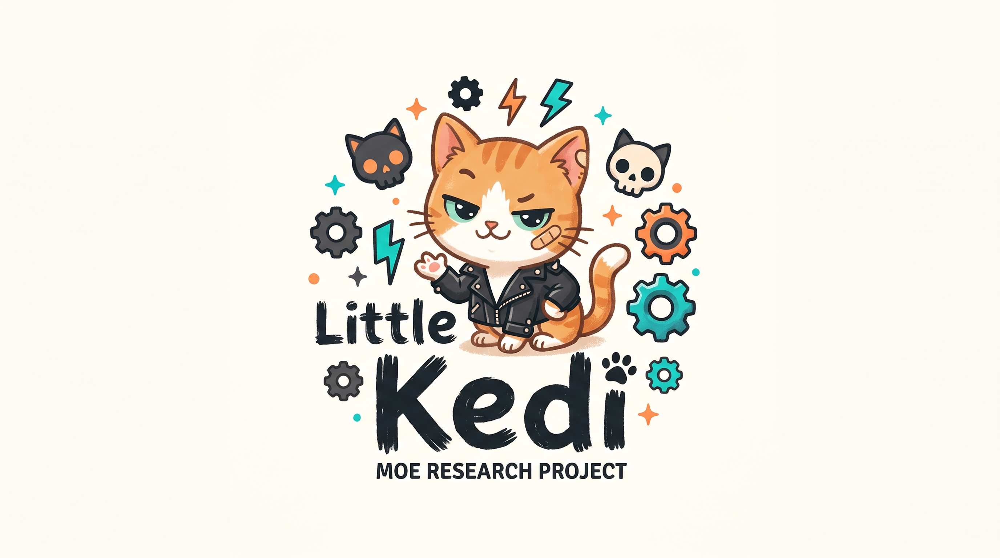

# LittleKedi-tiny-base



A 1.99M-parameter, DeepSeek-style Mixture-of-Experts language model built for small-scale experiments. It uses Multi-head Latent Attention (MLA), fine-grained routed experts, and tied input/output embeddings.

This repository contains the base checkpoint plus an inference-only experiment that expands the model with an extra MLP before the LM head. See [`expansion/`](expansion/README.md) for the full study.

## Model at a Glance

| Property | Value |
|---|---|
| Parameters (total) | 1,990,912 |
| Parameters (active per token) | 1,548,544 (77.8%) |
| Layers | 4 (1 dense + 3 MoE) |
| Hidden size | 128 |
| Attention | MLA, 4 heads |
| Context length | 1,024 tokens |
| Vocabulary | 8,192 (byte-level BPE) |
| Embeddings | Tied input/output, 1,048,576 params |
| Checkpoint dtype | float32 |
| Checkpoint metadata | `kind=base`, `preset=tiny`, `step=15257` |

## Architecture

| Component | Setting |
|---|---|
| Dense FFN | SwiGLU, hidden 352 |
| Routed experts | 8 per MoE layer, top-2 activated |
| Shared experts | 1 |
| Expert hidden size | 64 |
| MLA query compression | disabled (`q_lora_rank=0`) |
| MLA KV latent rank | 32 |
| QK content / RoPE dims | 16 / 16 per head |
| V head dim | 16 |
| RoPE theta | 10,000 |
| MoE backend | capacity-based, factor 2.0 |

The first layer is a dense SwiGLU block; the remaining three layers use DeepSeekMoE routing. Inactive routed experts account for 442,368 parameters, which is why only 77.8% of the model is active per token.

## Files

| File | Description |
|---|---|
| `config.json` | Model configuration |
| `model.safetensors` | Base checkpoint weights (7.6 MiB) |
| `tokenizer.json` | Byte-level BPE tokenizer, 8,192 tokens |
| `little_kedi.jpg` | Project image |
| `expansion/` | Pre-head expansion experiment, checkpoints, data, and results |

The tokenizer is a v1 tokenizer: it has `<|endoftext|>` but no chat role tokens. This is a base/completion model, not an instruction-tuned assistant.

## Quick Start

Requires Python 3.10–3.12. For inference:

```bash
python3 -m pip install torch tokenizers safetensors
```

Load the model and generate:

```python
import json
import sys

import torch
from safetensors.torch import load_file

sys.path.insert(0, "expansion/vendor")

from littlekedi import LittleKediModel, ModelConfig
from littlekedi.tokenizer import BPETokenizer

cfg = ModelConfig.from_dict(json.load(open("config.json")))
model = LittleKediModel(cfg)
model.load_state_dict(load_file("model.safetensors"), strict=True)
model.eval()

tok = BPETokenizer.from_file("tokenizer.json")

prompt = "The cat sat on the"
ids = tok.encode(prompt)
out = model.generate(
    torch.tensor([ids]),
    max_new_tokens=32,
    temperature=0.8,
    top_k=50,
)
print(tok.decode(out[0].tolist()))
```

`model.param_counts()` reports total, active, embedding, and active non-embedding parameters.

## Expansion Experiment

The [`expansion/`](expansion/README.md) subproject adds a 999,858-parameter residual MLP after the final RMSNorm and before the tied LM head, without touching the base weights. It compares three checkpoints:

- **A** — this base model
- **B** — random-control expansion
- **C** — externally designed expansion using an orthonormal QR frame

| Model | Total params | WikiText-2 PPL | Prefill 128 ms | Decode ms/tok | Peak RSS MiB |
|---|---:|---:|---:|---:|---:|
| A | 1,990,912 | **71.96** | **21.66** | **12.72** | **275.4** |
| B | 2,990,770 | 76.14 | 25.04 | 15.84 | 305.4 |
| C | 2,990,770 | 73.33 | 24.72 | 15.73 | 287.9 |

The expansion is mechanically valid and reproducible, but it is a net cost on the benchmark suite: no accuracy gain over A, worse perplexity, and higher latency. Full results and methodology are in [`expansion/README.md`](expansion/README.md) and [`expansion/results.md`](expansion/results.md).

## Upstream

The model implementation is vendored from LittleKedi at commit `a282a8fdc945d783e05b25b8dcd42fc493cf8f23`, under [`expansion/vendor/littlekedi/`](expansion/vendor/littlekedi/). The evaluation harness lives in [`expansion/src/`](expansion/src/).

## Limitations

- Small model with a 1,024-token context; capabilities are correspondingly limited.
- Base checkpoint only: no SFT, RLHF, or chat template.
- Evaluation results are CPU-only single runs and may not generalize.
- No license file is included in this repository.
